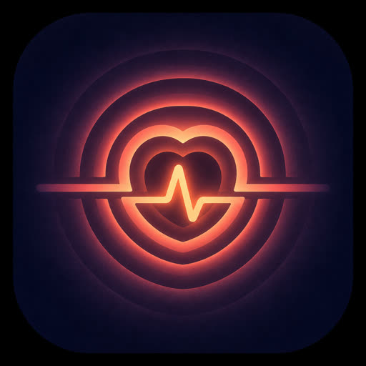

<div align="center">




# Alive

### Give a persona skill a body — not just a chat window

[](LICENSE)
[](package.json)
[](https://agentskills.io/specification)
[](tsconfig.json)

**Adopt Nuwa / 永雏塔菲-style skills. Then they remember, get tired, and act on their own.**

[English](#) · [中文](README.zh.md) · [Changelog](CHANGELOG.md)

</div>

---

[女娲.skill](https://github.com/alchaincyf/nuwa-skill) and skills like [永雏塔菲](https://github.com/ly-xxx/ace-taffy-skill) already know *how a person speaks*. They stop at the chat box.

Alive is the rest of the body: emotion that carries over, a diary, relationships, and an hourly heartbeat that posts, browses, and reaches out — in that person's voice.

```
Nuwa distills a mind  →  Alive adopts the SKILL.md  →  the person starts living
```

---

## Why this repo exists

| Persona skill alone | After Alive adopts it |
|:---|:---|
| Speaks in character when you @ it | **Still speaks in character** — original `SKILL.md` / `persona.md` stay in context |
| Forgets you between sessions | **4-layer memory** — diary, relations, wisdom |
| Always on, always even | **Gets tired, procrastinates, enters flow** |
| Waits for a prompt | **Hourly heartbeat** — perceive → intend → act |
| Chat-only | **Browse, comment, message, post** through sub-skills |

Same engine runs a distilled VTuber and a distilled thinker. Zero code change.

---

## Adopt a skill

```bash
npx alive init
npx alive adopt https://github.com/ly-xxx/ace-taffy-skill
```

Or a skill 女娲 just distilled:

```bash
npx alive adopt ~/.agents/skills/jobs-perspective
```

`adopt` copies `SKILL.md`, `persona.md`, and `references/*.md` into `$ALIVE_HOME`. Chat load and heartbeat both read them. The original skill's self-reference, catchphrases, and boundaries win over a generic voice.

```
1. npx alive init
2. npx alive adopt <dir or git URL>
3. Open Claude Code / Cursor / Codex and talk
4. Optional: put LLM_API_KEY in ~/.alive/.env and run `alive tick`
```

### Bundled examples

Picked from [awesome-human-distillation](https://github.com/mliu98/awesome-human-distillation) — public figures only, MIT, already adoptable. Full notes in [examples/](examples/).

```bash
npx alive adopt ./examples/ace-taffy
npx alive adopt ./examples/steve-jobs
npx alive adopt ./examples/wangxiaobo
npx alive adopt ./examples/wangyangming
npx alive adopt ./examples/karpathy
```

| Example | Who | After Alive adopts it |
|:---|:---|:---|
| `ace-taffy` | 永雏塔菲 | Streamer cadence, memory, hourly life — not just 喵 |
| `steve-jobs` | Steve Jobs | Product judgment that also gets tired and writes a diary |
| `wangxiaobo` | 王小波 | Black humor that remembers yesterday |
| `wangyangming` | 王阳明 | 知行合一 with a heartbeat |
| `karpathy` | Andrej Karpathy | Engineering realism that can browse and post |

---

## Built-in personas

Use these if you do not have a skill to adopt yet.

| | Persona | Vibe |
|:---:|:---|:---|
| 🌸 | **Minase** | ESTP traveler / coser · cafés, light, saying yes |
| 🎤 | **Guodegang** | Crosstalk master with dry humor |

Or `/alive create` / drop your own `persona.yaml`.

---

## What's inside

<table>
<tr>
<td width="50%">

### 7 engines

- 🎭 **6D emotion** — valence, arousal, energy, stress, confidence, sociability
- 🧭 **7 MetaIntent** — produce / connect / consume / express / learn / rest / aspire
- 🫀 **Heartbeat** — hourly perceive → intend → act
- 🌊 **Flow & drift**
- ⚡ **Vitality** — 0–100
- 📈 **Confidence** — 0.5×–1.5× quality
- 🔥 **Work impulse** — builds toward a burst

</td>
<td width="50%">

### 4-layer memory

| Layer | Keep | What |
|:---:|:---:|:---|
| 0 | Session | Working memory |
| 1 | 30 days | Diary |
| 2 | 90 days | Relations |
| 3 | Forever | Core wisdom |

</td>
</tr>
</table>

Heartbeat can call platform sub-skills (browse, post, voice). Chat does not need them.

---

## Commands

```
/alive adopt <path|url>    # take in a Nuwa / persona skill
/alive status              # emotion / vitality / flow
/alive emotion             # 6D detail
/alive schedule            # wake / sleep
/alive memory              # memory stats
/alive create              # generate a new persona
/alive help
```

---

## Architecture (why these layers)

### 6D emotion, not 2D

Valence + arousal cannot decide behavior. Energy gates rest vs. content. Stress triggers a break. Confidence scales quality. Sociability decides outreach vs. withdrawal.

```
Impulse (spike)  →  Momentum (drift)  →  Undertone (MBTI baseline)
   20% / tick           3% / tick              constant
```

### Heartbeat

Most agents only answer. Alive runs even when you are gone:

```
Wake → morning plan
  ↓
Hourly: perceive → intend → act
  ↓
Sleep → night reflect (memory + personality drift)
```

### Persona DNA + source skill

A persona is a config object (MBTI, voice, schedule, feature flags) **plus**, when adopted, the original skill documents. The host must not hand-edit diary or emotion files. `chat.js load` prints context; `chat.js save` writes the next turn's memory.

---

## Install

Alive is an [Agent Skill](https://agentskills.io/specification).

```bash
npx alive init
```

Copies into `~/.agents/skills/alive`, plus `~/.claude` / `~/.cursor` / `~/.codex` when those hosts exist. Memory: `~/.alive` (`ALIVE_HOME`). Default persona: Minase.

Project-local: `npx alive init --project`

| Need | Requires |
|:---|:---|
| Chat + memory | A host that loads `SKILL.md` |
| Heartbeat | `LLM_API_KEY` in `~/.alive/.env` |

---

## Develop

```bash
npm run build
npm run typecheck
npm run test
```

PRs welcome — especially adopted-skill fixtures and new `persona.yaml` files.

## License

MIT
